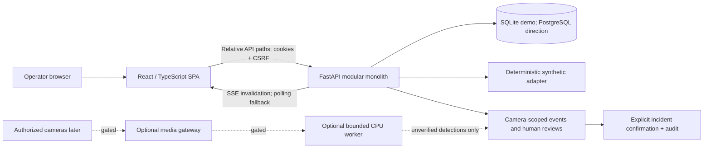
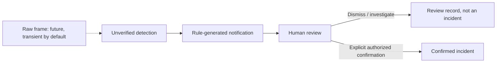

# IESMMG — Architecture and Scope Decision Record

**Status:** APPROVED synthetic-only foundation implemented; final owner acceptance UNDER REVIEW.
**Initial proposal:** 2026-11-01. **Implementation reconciliation:** 2026-11-02.
**Institution:** IES Manuel Martín González, Guía de Isora, Tenerife, Spain.
**Working branch:** `arena/93b885b1-ies-mmg`.

> Owner approval covers the bounded simulation foundation and Spanish/English interface. It does not authorize school camera/network access, real footage, recording, biometric processing, institutional deployment, hosting procurement, shared-branch merge or release.

This document supersedes the initialization-era statements that no application existed. It preserves the distinction between **confirmed requirements**, **observed facts**, **implemented/tested behavior**, **proposals**, and **institutional decisions**. Current evidence is in [PROJECT_STATUS.md](PROJECT_STATUS.md) and [TESTING.md](TESTING.md).

## 1. Project overview

The confirmed mission is one coherent intelligent CCTV security dashboard covering camera configuration/groups/health, modular analysis, monitoring/history/incidents, professional operator UX, and authentication/RBAC/audit/administration. Security, correctness, privacy, integration reliability, maintainability, documentation accuracy and measured performance take precedence over feature count.

The starting repository contained only an empty `.gitignore` at commit `d8bc16abaeef0dd1cda5089c2d18c0356582efb5`. The remote default was `main`; the existing development-like ref was spelled `Developement`. The owner subsequently confirmed that existing ref as the normal-development target. This session remains on its fixed Arena branch and does not modify either shared ref.

The implemented slice provides authenticated synthetic cameras/events, human review, explicit incident confirmation, configuration and audit. It is a product foundation, not a surveillance deployment. School systems accessed, real credentials used, and real footage collected: **zero**.

## 2. System architecture

**APPROVED / IMPLEMENTED FOR SIMULATION:** React SPA → same-origin versioned FastAPI modular monolith → relational persistence. The simulation adapter is inside the API process; no media or inference worker is deployed.

Dashed components are not implemented. Domain boundaries live in routers, schemas, security helpers, models and the simulation module. This is a small modular monolith, not a claim of a fully layered enterprise repository framework. Separate workers/services require measured isolation, load or security needs; no Kubernetes, broker or cloud-specific queue is assumed.

## 3. Technology stack

The validated baseline is Python 3.11.2, FastAPI, Pydantic 2, SQLAlchemy 2, Alembic, Argon2id, SQLite for local demonstration; React/TypeScript, Vite, Tailwind plus project CSS, TanStack Query and lucide icons. Exact pins and licenses are in [DEPENDENCIES.md](DEPENDENCIES.md).

The original Python 3.13/Node 24 targets and PostgreSQL 18 candidate were **not silently treated as tested**. The manifests allow a range, while evidence identifies the actual Python 3.11/Node 22 runtime. PostgreSQL remains the production direction with Psycopg 3 locked but server integration unvalidated. MediaMTX/WebRTC remains a candidate, not a dependency or approved topology. CPU-first inference remains a later spike; no GPU or model is assumed.

## 4. Front-End architecture

Implemented areas: bilingual login; overview; camera grid/compact layout/search/groups; synthetic detail/configuration; event filters/cursor history; review and explicit confirmation; incident records; administrator camera registration, access metadata and audit; notifications; health and honest unavailable/error states.

- `App.tsx` owns workspace navigation and query composition; focused components own login, camera cards/scenes/detail, review, administration and reusable UI states.
- Generated OpenAPI types feed the typed fetch client. CSRF remains in memory; only locale/layout preferences use local storage.
- Camera-group filtering and event-camera filtering are independent. Incident details fetch the authorized event by ID rather than assuming it is in the current page.
- Query polling and SSE invalidation keep data fresh; a protected 401 clears cached account data.
- Responsive layouts, native modal dialogs, visible focus, skip link, mobile focus containment/restoration, reduced motion and text-plus-color statuses are implemented.
- English/Spanish dictionaries have completeness tests. Automated axe checks cover the implemented main views and selected dialogs/admin/mobile states in both languages where applicable.

This is not a full accessibility conformance claim. Independent human/assistive-technology review remains open. The authentic institutional emblem is still **BLOCKED**; the product wordmark explicitly discloses that no official emblem has been verified. No substitute school symbol was generated.

## 5. Back-End architecture

Implemented modules: configuration/database lifecycle; identity and session security; camera metadata/grants/diagnostics; synthetic stream authorization; event/review/incident lifecycle; administrator reads/audit; health/summary/SSE; deterministic simulation and seeding.

Production environment values fail validation. Only `demo` and `test` start. Mutations require CSRF and server-side permissions. Administrators manage all camera metadata but need explicit grants for scenes/events; dashboard counts follow those grants. New cameras start unknown. Source input accepts only `simulation` and rejects extra URL/credential fields.

Review and incident confirmation are separate. Version-conditioned updates guard stale changes; confirmation requires rationale and creates the incident/review/state/audit transaction together. The API reference and negative tests are in [API.md](API.md) and [TESTING.md](TESTING.md).

## 6. Dependencies and versions

`uv.lock` and `package-lock.json` are checked in. The inventory contains 67 Python and 342 npm lock entries, including optional/transitive entries. Dependency advisories found during review were remediated and audits rerun. See [DEPENDENCIES.md](DEPENDENCIES.md) for direct pins, runtime qualifications, license declarations and override rationale. A clean advisory snapshot is not a security certificate or legal license review.

## 7. Database architecture

Implemented entities: `users`, `sessions`, `camera_groups`, `cameras`, `camera_grants`, `events`, `reviews`, `incidents`, `audit_events`.

- Opaque session-token hashes, not plaintext tokens, are persisted.
- Explicit grants constrain event/scene access; administrator metadata privilege is separate.
- Events distinguish observation/receipt time, source environment, detector/model metadata, score, review state and version.
- Reviews preserve human rationale; incidents require a confirming actor/time and have a unique event reference.
- Audit entries identify actor/action/resource/time without embedding review narratives or camera secrets.
- SQLite foreign keys are enabled. API timestamps serialize explicitly as UTC; naive SQLite values are interpreted as UTC.

Initial Alembic revision `06ed0e8980ed` passed SQLite upgrade, schema comparison, downgrade and re-upgrade. Demo startup uses create-all/seed convenience; a future production database must use reviewed migrations, not bootstrap DDL. PostgreSQL transactions/concurrency, backups, retention, roles and restore remain unvalidated. Downgrade destroys application data and is for disposable validation only.

## 8. API documentation

The source of truth is now [`contracts/openapi.json`](../contracts/openapi.json), exported from the actual app, with generated frontend types in `apps/web/src/api/schema.d.ts`. It exposes 17 paths / 22 operations under `/api/v1`. [API.md](API.md) describes semantics, role/grant boundaries, errors, pagination and SSE. [OPERATIONS.md](OPERATIONS.md) gives export/check commands.

The earlier conceptual endpoint list is superseded. No real-media, inference, recording or biometric endpoint exists. Contract changes require provider/consumer review and regenerated types, not parallel hand-written schemas.

## 9. CCTV integration

**NOT STARTED beyond simulation.** No RTSP socket, ONVIF discovery, gateway, camera credential, codec test or real stream exists. Synthetic diagnostics do not probe a network. Stream-session responses authorize an illustration only and contain no media URL.

Future direction: explicit authorized source registration; a replaceable camera adapter; MediaMTX/WebRTC candidate for browser delivery; RTSP terminated server-side; ONVIF/PTZ deferred until actual device requirements and compatibility are confirmed. Source allowlists, SSRF/DNS/redirect controls, write-only secrets, independently enforced short-lived camera/path capabilities, session limits and redacted diagnostics are mandatory gates. No camera manufacturer, existing VMS or network topology is assumed.

## 10. AI processing architecture

**Simulation implemented; model inference NOT STARTED.** Fixture scores are not model accuracy or incident probability. The required evidence lifecycle remains:

The demo combines synthetic detections and notifications but never automatically confirms an incident. A future detector receives bounded frames/camera/time/zones and returns model/version/class/score/geometry/uncertainty; it cannot emit a confirmed incident. CPU motion analysis precedes small object-model evaluation on synthetic or explicitly authorized material. Sampling, queues, backpressure and resource measurements are required. No model/weights, accuracy, camera capacity or real-time guarantee is claimed.

Facial recognition, biometric identification and automated adverse/disciplinary decisions are excluded without separate owner authorization and legal/technical assessment.

## 11. Infrastructure requirements

Local, external and hybrid hosting remain **undecided**. No school hardware, GPU, bandwidth, camera count, budget, identity provider or VMS is confirmed. The validated development host is not a proposed production specification.

Before deployment, obtain authorized information about camera models/codecs/count, network segmentation, existing systems, operators, retention, availability, support, budget and hosting constraints. Use a questionnaire/owner consultation, not network probing. Native processes are sufficient for this demo; containers and orchestration are optional future packaging decisions. Docker/FFmpeg/PostgreSQL server were absent and are not represented as tested.

## 12. Environment configuration

The API uses `IESMMG_*` settings and an ignored optional `.env`; `.env.example` contains no real secrets. Browser code uses relative API paths. Vite's internal proxy target is server-side configuration, not a browser localhost dependency. Secure cookies, exact extra origin, session lifetime and simulation interval are configurable.

The demo's permissive preview host binding and HTTP cookies are explicit development exceptions. Production identity/TLS/hosts/egress/secrets are gated. Full variables and safe examples are in [OPERATIONS.md](OPERATIONS.md).

## 13. Installation instructions

A frozen local installation/runbook now exists in [OPERATIONS.md](OPERATIONS.md), using uv 0.13.6 and npm lockfiles. The browser package supplies its Linux/x64 test binary/libraries; other platforms can supply an approved Chromium path. No real camera SDK, model weights or media binary is required. Clean-install evidence and remaining platform limitations are recorded in [TESTING.md](TESTING.md).

## 14. Execution procedures

Run Uvicorn from `services/api` and Vite from `apps/web`; open port 3000. The Arena preview uses the proxied port-3000 host. Playwright owns separate 8001/3001 servers with an in-memory database and simulation disabled. Backend source changes require local-package reinstall or `PYTHONPATH=src`, then server restart. Exact commands, health checks and shutdown are in [OPERATIONS.md](OPERATIONS.md).

## 15. Security architecture

Implemented controls include Argon2id, hashed opaque sessions, CSRF/origin checks, process-local failed-login throttling, role/grant enforcement, strict schemas, optimistic concurrency, audit, no-store responses and explicit synthetic-only boundaries. SSE revalidates access; protected 401s clear frontend data.

No penetration test, production threat-model approval, MFA, distributed abuse protection, hardened deployment, tamper-evident audit store or security certification is claimed. See [SECURITY_AND_PRIVACY.md](SECURITY_AND_PRIVACY.md) for negative-test evidence and open risks.

## 16. Privacy considerations

The foundation uses synthetic data only. Real processing requires school/controller, IT and authorized DPO/legal assessment under GDPR, LOPDGDD, video-surveillance rules and the actual applicability of EU AI Act obligations. Minors increase the need for necessity/proportionality, minimization and restricted access. Lawful basis, DPIA, coverage, notices, retention/deletion, hosting/transfers, human oversight and breach response are institutional decisions, not assumptions encoded by this prototype.

No consent basis, universal retention period, external AI transfer or biometric permission is invented. Technical feasibility isn't legal authorization. The detailed gate checklist is in [SECURITY_AND_PRIVACY.md](SECURITY_AND_PRIVACY.md).

## 17. Testing procedures

The implemented foundation has 22 backend tests, 13 frontend unit tests and 12 browser scenarios passing, plus static/contract/migration/audit gates. Automated accessibility checks pass for the documented states; manual independent review and production/load/recovery tests remain open. One upstream TestClient deprecation warning is disclosed. [TESTING.md](TESTING.md) records commands, environment, mocked versus real integration coverage, corrected failures and unverified claims.

## 18. Troubleshooting

[OPERATIONS.md](OPERATIONS.md) contains observed fixes for missing local-package imports, browser NSS/NSPR libraries, proxy/CSRF/secure-cookie problems, test-port conflicts, stale contracts, missing grants and synthetic unavailable states. It distinguishes validated local fixes from future gateway/worker/database troubleshooting that cannot yet be tested.

## 19. Known limitations

- No real video, model, recording, biometric processing, camera compatibility or school deployment.
- No PostgreSQL server, container, TLS production proxy, backup/restore or multi-process operational validation.
- No measured load/latency/availability SLO, distributed rate limiter, durable notification outbox or retention/deletion service.
- User/grant administration is read-only except automatic creator grants; group fixtures are not a full group-management CRUD product.
- Incident/audit history is bounded to the latest 100; events support cursor pagination. No export/archive workflow.
- Original institutional emblem and all required official brand variants remain blocked.
- Python 3.11/Node 22 and Linux/x64 Chromium are the tested combination; broader manifest ranges are not compatibility evidence.
- Automated accessibility is not full WCAG certification; independent human review remains open.
- Prototype approval does not authorize release, shared-branch integration or institutional use.

## 20. Changelog

- **2026-11-01:** inspected the empty repository; proposed the architecture, four responsibility roles, 20-topic documentation map and institutional gates; recorded emblem acquisition failure without substituting artwork.
- **2026-11-02:** captured owner approval for the synthetic foundation, `Developement` spelling and English/Spanish UI; implemented and integrated the slice; corrected security/accessibility/pagination/test findings; synchronized actual contracts, runbooks and evidence. No release or institutional integration occurred.

Detailed unreleased changes are in [CHANGELOG.md](CHANGELOG.md).

## Appendix A — Decision and approval register

| ID | Decision | State | Authority / qualification |
| --- | --- | --- | --- |
| D-01 | React/FastAPI modular monolith; relational persistence; simulation first | APPROVED for foundation | Owner approved bounded implementation; PostgreSQL server validation still open. |
| D-02 | No school access, real credentials/feeds or footage | Confirmed restriction | Separate institutional authorization required to change. |
| D-03 | MediaMTX/WebRTC candidate; RTSP later; ONVIF deferred | Proposed | Not installed or integrated. |
| D-04 | CPU-first modular inference; biometric exclusion | Proposed direction / confirmed exclusion | No model selected; separate authorization and assessment for biometrics. |
| D-05 | Local/external/hybrid hosting | Open institutional decision | No provider/hardware commitment. |
| D-06 | Existing `Developement` as normal-development target | APPROVED spelling/target | Owner confirmed; this session still cannot merge or switch from its fixed branch. |
| D-07 | Authentic original emblem required | BLOCKED | Owner must supply original/provenance; no approximation. |
| D-08 | Spanish and English operator interface | APPROVED / implemented | Owner selected both; independent accessibility review still open. |
| D-09 | Exact foundation dependency pins | Implemented / UNDER REVIEW | Locks and actual test evidence exist; future changes need review. |
| D-10 | Recording, retention, identity/MFA, deployment and release | NOT AUTHORIZED | Owner/school/IT/DPO decisions and release gate required. |

## Appendix B — Historical proposal preservation

The 2026-11-01 proposal was delivered before implementation and owner approval. Its initial candidate versions, empty-repository metrics and “not implemented” labels described that date only. This reconciled record retains the scope/decision history while current operational claims point to implemented artifacts and dated tests. Earlier unreachable draft commits are not cited as durable evidence; the final implementation commit on the fixed working branch is the durable handoff.